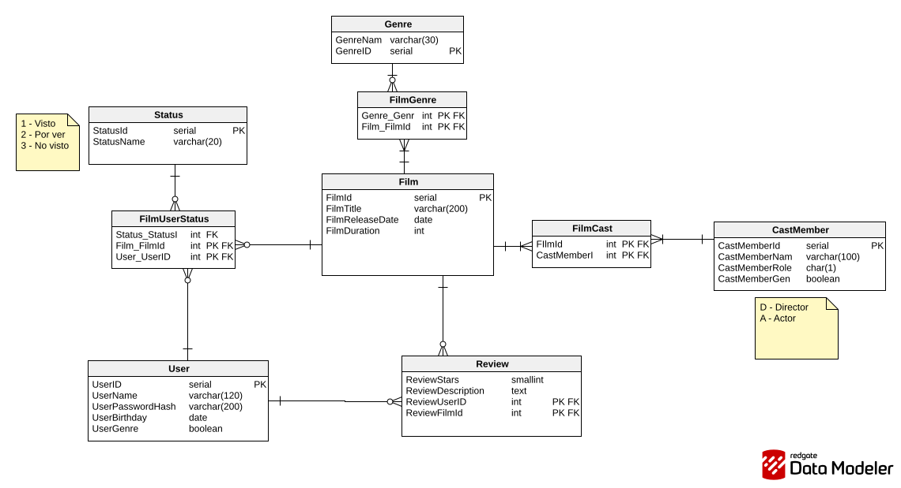

# TPGrupalWeb

## Introducción

TP de la cátedra Programación Web (UNICEN) — API REST HTTP en Go (sobre `:8080`) para gestionar una base de datos de películas: usuarios, films, géneros, reparto, reviews y el estado de visualización de cada usuario por película.

El objetivo del TP es exponer las operaciones CRUD de todas las entidades y relaciones a través de endpoints HTTP estructurados en capas (`handler`, `service`, `repository` y `errors`), junto con su suite de pruebas.

## Modelo de entidades

El diagrama completo de entidades y relaciones está en [`EntidadesPrincipales.svg`](./EntidadesPrincipales.svg):



## Estructura del repo

```
.
├── db/
│   ├── schema/                # DDL de las tablas (Postgres)
│   ├── queries/               # Queries .sql usadas por sqlc
│   └── sqlc/                  # Código Go generado por sqlc
├── internal/                  # Lógica de la API dividida en capas (handler, service, repository, errors)
│   ├── film/                  # Endpoints /films y /films/{id}
│   ├── user/                  # Endpoints /users y /users/{id}
│   ├── genre/                 # Endpoints /genres y /genres/{id}
│   ├── status/                # Endpoints /statuses y /statuses/{id}
│   ├── castmember/            # Endpoints /castmembers y /castmembers/{id}
│   ├── review/                # Endpoints /reviews y /reviews/{filmID}/{userID}
│   ├── filmcast/              # Endpoints /filmcasts y /filmcasts/{filmID}/{castMemberID}
│   ├── filmgenre/             # Endpoints /filmgenres y /filmgenres/{genreID}/{filmID}
│   └── filmuserstatus/        # Endpoints /filmuserstatuses y /filmuserstatuses/{filmID}/{userID}
├── CRUDSimple_test.go         # Tests de BD para CRUD simple (Film, User, Genre, Status, CastMember)
├── CRUDCompuesto_test.go      # Tests de BD para relaciones (Review, FilmCast, FilmGenre, FilmUserStatus)
├── requests.bash              # Script de prueba integral de todos los endpoints HTTP con curl
├── Dockerfile
├── docker-compose.yml
├── Makefile
├── sqlc.yaml
├── go.mod / go.sum
└── main.go
```

## Requisitos

- Go 1.26+
- Docker y Docker Compose
- sqlc
- `curl` y `bash` (para ejecutar `./requests.bash`)

## Setup

1. Clonar el repositorio y hacer checkout sobre el branch correcto (`tp3`):

```bash
   git clone https://github.com/IgnacioBarboza/TPGrupalWeb/
   cd TPGrupalWeb
   git checkout tp3
```

2. Levantar todo, ejecutar el batch de pruebas HTTP y apagar con un solo comando (copia automáticamente `.env.example` a `.env`):

```bash
   make start
```

Esto copia `.env`, regenera el código de `sqlc`, limpia los volúmenes de la base de datos, construye y levanta los contenedores en segundo plano, ejecuta todas las pruebas HTTP con `./requests.bash` y apaga los contenedores al finalizar.

Para ver todos los comandos disponibles:

```bash
make help
```

Los más usados:

| Comando               | Qué hace                                                              |
| --------------------- | --------------------------------------------------------------------- |
| **make start**        | Limpia BD, levanta Docker, corre `requests.bash` y apaga (all-in-one) |
| **make StartServer**  | Levanta el servidor en primer plano para pruebas manuales             |
| **make StopServer**   | Frena el servidor conservando los datos de la BD                      |
| **make cleanDB**      | Frena el servidor y borra los volúmenes de la BD (reinicia IDs)       |
| **make test**         | Ejecuta `go test` dentro del contenedor                               |
| **make upDocker**     | Inicia los contenedores en segundo plano                              |
| **make downDocker**   | Frena los contenedores                                                |
| **make rebuild**      | Reconstruye y levanta los contenedores                                |
| **make generatesqlc** | Borra y regenera el código de `sqlc` en `db/sqlc/`                    |

## Tests

El proyecto cuenta con dos tipos de pruebas:

### 1. Pruebas de Endpoints HTTP (`requests.bash`) — _Incluidas en `make start`_

Prueba el conjunto completo de "curl" (`POST` unitario, `POST` masivo, `GET` colección, `GET` por ID/clave compuesta, `PUT` y `DELETE`) sobre las 9 entidades de la API en `http://localhost:8080`, informando y contando si hubo algún error HTTP (`4xx`/`5xx`).

Si tenés el servidor levantado con `make StartServer`, también podés correrlo manualmente:

```bash
./requests.bash
```

### 2. Tests de capa de datos en Go (`go test`)

Prueban directamente las consultas de `sqlc` contra Postgres dentro del contenedor (con los contenedores levantados):

```bash
make test
```

Están separados en dos archivos:

- **CRUDSimple_test.go**: CRUD de entidades con clave simple (`Film`, `User`, `Genre`, `Status`, `CastMember`).
- **CRUDCompuesto_test.go**: CRUD sobre las tablas de relación con clave compuesta (`Review`, `FilmCast`, `FilmGenre`, `FilmUserStatus`).
