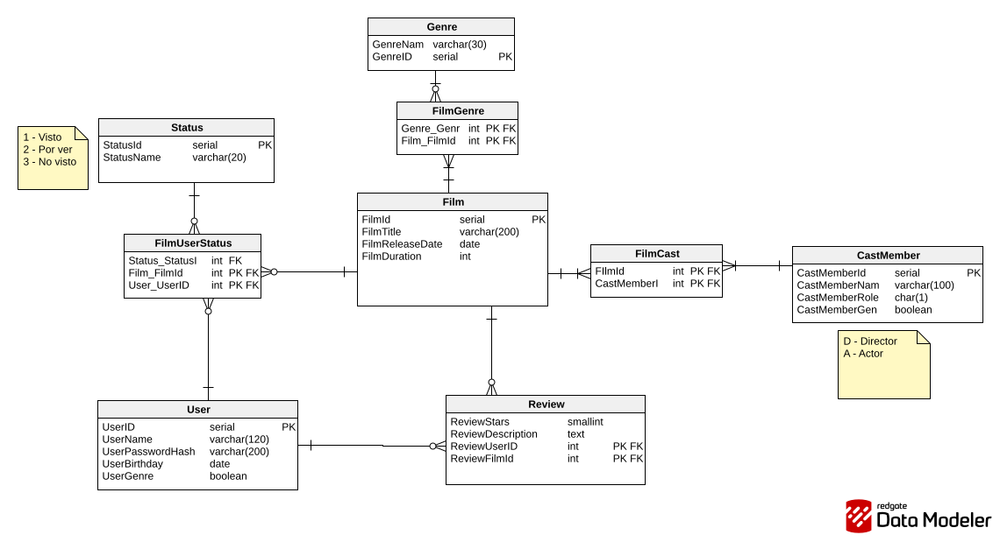

# TPGrupalWeb

## Introducción

TP de la cátedra Programación Web (UNICEN). Aplicación web en Go (sobre `:8080`) para gestionar una base de datos de películas: usuarios, films, géneros, reparto, reviews y el estado de visualización de cada usuario por película.

El renderizado se hace del lado del servidor con **templ**: el servidor Go genera el HTML completo de la página y los formularios hacen `POST` clásicos y recargan la página entera..

## Cómo funciona

| Ruta                     | Qué hace                                                                                                          |
| ------------------------ | ----------------------------------------------------------------------------------------------------------------- |
| `GET /`                  | Obtiene todos los registros de las 9 entidades (métodos `Get...` de sqlc) y renderiza la página con `views.Index` |
| `POST /<entidades>`      | Parsea el formulario, crea el registro (métodos `Create...` de sqlc) y redirige a `/` con `303 See Other`         |
| `GET /static/styles.css` | Hoja de estilos propia (además de Pico.css desde CDN)                                                             |

Rutas de creación: `/films`, `/genres`, `/castmembers`, `/statuses`, `/users`, `/reviews`, `/filmcasts`, `/filmgenres`, `/filmuserstatuses`.

Si los datos del formulario no son válidos (campo vacío, número o fecha con formato incorrecto, estrellas fuera de 1–5, IDs ≤ 0) la respuesta es `400 Bad Request`.

## Modelo de entidades

El diagrama completo de entidades y relaciones está en [`EntidadesPrincipales.svg`](./EntidadesPrincipales.svg):



## Estructura del repo

```
.
├── db/
│   ├── schema/                # DDL de las tablas (Postgres)
│   ├── queries/               # Queries .sql usadas por sqlc
│   └── sqlc/                  # Código Go generado por sqlc (no se versiona)
├── internal/                  # Lógica dividida en capas (handler (POST de las tablas), service, repository, errors)
│   ├── dto.go                 # Structs compartidos entre capas y vistas
│   ├── film/                  
│   ├── user/                  
│   ├── genre/                 
│   ├── status/                
│   ├── castmember/            
│   ├── review/                
│   ├── filmcast/              
│   ├── filmgenre/             
│   └── filmuserstatus/        
├── views/                     # Componentes templ (+ los *_templ.go generados)
│   ├── layout.templ           # Estructura base (HTML, HEAD con Pico.css, BODY) y página Index
│   ├── entity_form.templ      # Formularios de creación de cada entidad
│   └── entity_list.templ      # Listas de registros de cada entidad
├── static/
│   └── styles.css             # Hoja de estilos
├── CRUDSimple_test.go         # Tests de BD para CRUD simple (Film, User, Genre, Status, CastMember)
├── CRUDCompuesto_test.go      # Tests de BD para relaciones (Review, FilmCast, FilmGenre, FilmUserStatus)
├── requests.hurl              # Pruebas HTTP de los formularios (Post/Redirect/Get) con Hurl
├── Dockerfile
├── docker-compose.yml
├── Makefile
├── sqlc.yaml
├── go.mod / go.sum
└── main.go                    # Inicializa servicios, registra rutas y renderiza GET /
```

## Requisitos

- Go 1.26+
- Docker y Docker Compose
- [sqlc](https://sqlc.dev)
- [templ](https://templ.guide)
- [Hurl](https://hurl.dev)

## Setup

1. Clonar el repositorio y hacer checkout sobre el branch `tp5`:

```bash
git clone https://github.com/IgnacioBarboza/TPGrupalWeb/
cd TPGrupalWeb
git checkout tp5
```


Hacer todo de una (BD limpia, regenerar sqlc y templ, levantar Docker, correr las pruebas de Hurl y apagar):

```bash
make start
```

2. Alternativamente, levantar el servidor para usarlo desde el navegador (copia `.env.example` a `.env`, genera sqlc si falta y regenera templ):

```bash
make start-server
```

Abrir [http://localhost:8080](http://localhost:8080): se ven todas las listas y se pueden crear registros desde los formularios (cada envío recarga la página completa). Para frenarlo: `Ctrl+C` o `make stop-server`.

## Comandos

Para ver todos los comandos disponibles:

```bash
make help
```

Los más usados:

| Comando                 | Qué hace                                                                        |
| ----------------------- | ------------------------------------------------------------------------------- |
| **make start**          | Limpia BD, regenera sqlc y templ, levanta Docker, corre `requests.hurl` y apaga |
| **make start-server**   | Regenera templ y levanta el servidor en primer plano                            |
| **make stop-server**    | Frena el servidor conservando los datos de la BD                                |
| **make clean-db**       | Frena el servidor y borra los volúmenes de la BD (reinicia IDs)                 |
| **make test**           | Ejecuta `go test` dentro del contenedor                                         |
| **make generate-templ** | Borra y regenera los `*_templ.go` de `views/`                                   |
| **make generate-sqlc**  | Borra y regenera el código de `sqlc` en `db/sqlc/`                              |
| **make rebuild**        | Reconstruye y levanta los contenedores                                          |

## Tests

### Pruebas HTTP de los formularios (`requests.hurl`) — _incluidas en `make start`_

Prueban el patrón Post/Redirect/Get de las 9 entidades en `http://localhost:8080`:

- cada `POST /<entidades>` válido debe responder `303` con `Location: /`;
- los `POST` inválidos deben responder `400`;
- después, `GET /` debe mostrar el registro creado. Los IDs se capturan del HTML para crear las relaciones (FilmCast, FilmGenre, FilmUserStatus y Review).

Con el servidor levantado (`make start-server`) también se pueden correr a mano:

```bash
hurl --test requests.hurl
```

