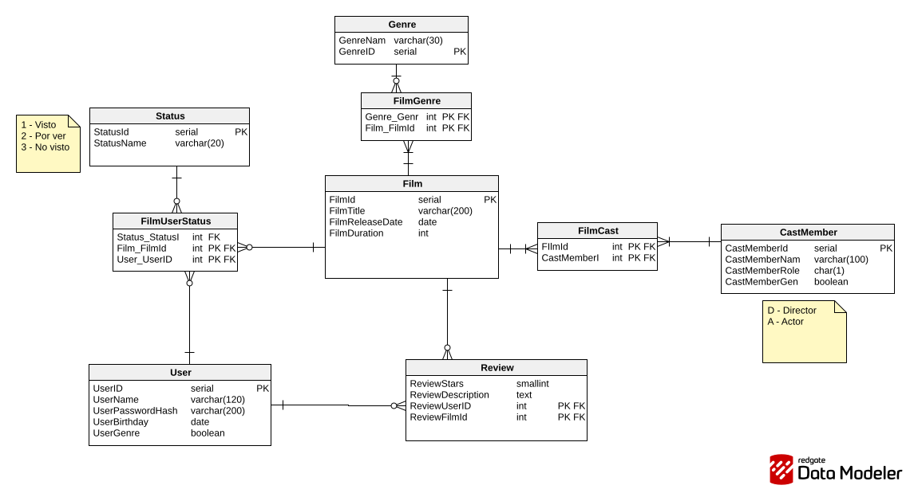

# TPGrupalWeb

## Introducción

TP de la cátedra Programación Web (UNICEN). Aplicación web en Go (sobre `:8080`) para gestionar una base de datos de películas: usuarios, films, géneros, reparto, reviews y el estado de visualización de cada usuario por película.

El renderizado se hace del lado del servidor con **templ**, y desde el TP6 usamos HTMX para que la página no se recargue: crear, editar y borrar actualizan solo el pedazo de HTML que cambia (una lista o una fila).

## Cómo funciona

| Ruta                                | Qué hace                                                                                                                       |
| ----------------------------------- | ------------------------------------------------------------------------------------------------------------------------------ |
| `GET /`                             | Obtiene todos los registros de las 9 entidades (métodos `Get...` de sqlc) y renderiza la página completa con `views.Index`     |
| `GET /<entidades>`                  | Devuelve solo la lista de esa entidad (fragmento HTML)                                                                         |
| `POST /<entidades>`                 | Crea el registro. Si el pedido viene de HTMX devuelve la lista actualizada; si no, redirige a `/`.     |
| `GET /<entidades>/{id}`             | Devuelve la fila de un registro (la usa el botón Cancelar de la edición)                                                       |
| `GET /<entidades>/{id}/edit`        | Devuelve la fila convertida en formulario de edición                                                                           |
| `PUT /<entidades>/{id}`             | Guarda los cambios  y devuelve la fila actualizada                                                |
| `DELETE /<entidades>/{id}`          | Borra el registro y responde `200` vacío, así HTMX saca la fila de la lista                                                    |
| `GET /static/...`                   | `styles.css` y `js/htmx.min.js`                                                                 |

Las FOREIGN KEYS tienen ON DELETE CASCADE: borrar una película también borra sus reseñas, géneros asignados, elenco y estados de usuario. Por eso los botones Borrar de las tablas "padre" piden confirmación (hx-confirm) diciendo qué más se va a borrar.

## Decisiones

Para que las listas se actualicen cuando borramos algo en cascada (por ejemplo, la relación película-género al borrar una película) usamos HX-Trigger: el DELETE avisa con un evento y cada lista afectada se vuelve a pedir sola. También evaluamos usar hx-partial con un handler en main.go que devuelva todas las listas juntas, y pasarle a FilmHandler los services de las otras tablas. Teniendo en cuenta el TRADE-OFF de que se genere una petición por lista afectada y el tamaño del projecto, decidimos utilizar HX-TRIGGER, ya que mantiene simple los handlers y deriva esta responsabilidad a la libreria de HTMX.

Además de lo pedido en la consigna, decidimos agregar un boton con el texto de "Editar". El mismo genera un formulario reemplazando la fila de la tabla, permitiendo editar los campos y luego hacer una petición de metodo: PUT. Lo decidimos agregar debido a las correciones hechas en el TP5, ya que teniamos solamente los Handlers para el POST, GET y DELETE (faltando el UPDATE). 

## Modelo de entidades

El diagrama completo de entidades y relaciones está en [`EntidadesPrincipales.svg`](./EntidadesPrincipales.svg):



## Estructura del repo

```
.
├── db/
│   ├── schema/                # DDL de las tablas (Postgres)
│   ├── queries/               # Queries .sql usadas por sqlc
│   └── sqlc/                  # Código Go generado por sqlc (no se versiona)
├── internal/                  # Lógica dividida en capas (handler (GET/POST/PUT/DELETE de las tablas), service, repository, errors)
│   ├── dto.go                 # Structs compartidos entre capas y vistas
│   ├── film/                  
│   ├── user/                  
│   ├── genre/                 
│   ├── status/                
│   ├── castmember/            
│   ├── review/                
│   ├── filmcast/              
│   ├── filmgenre/             
│   └── filmuserstatus/        
├── views/                     # Componentes templ (+ los *_templ.go generados)
│   ├── layout.templ           # Estructura base (HTML, HEAD con HTMX, BODY) y página Index
│   ├── entity_form.templ      # Formularios de creación de cada entidad (hx-post)
│   └── entity_list.templ      # Listas y filas de cada entidad, con los botones Editar (hx-put) y Borrar (hx-delete)
├── static/
│   ├── js/htmx.min.js         # HTMX servido localmente
│   └── styles.css             # Hoja de estilos
├── Dockerfile
├── docker-compose.yml
├── Makefile
├── sqlc.yaml
├── go.mod / go.sum
└── main.go                    # Inicializa servicios, registra rutas y renderiza GET /
```

## Requisitos

- Go 1.26+
- Docker y Docker Compose
- [sqlc](https://sqlc.dev)
- [templ](https://templ.guide)

## Setup

1. Clonar el repositorio y hacer checkout sobre el branch `tp6`:

```bash
git clone https://github.com/IgnacioBarboza/TPGrupalWeb/
cd TPGrupalWeb
git checkout tp6
```

2. Levantar el servidor para usarlo desde el navegador (copia `.env.example` a `.env`, genera sqlc si falta y regenera templ):

```bash
make start-server
```

Abrir [http://localhost:8080](http://localhost:8080): se ven todas las listas y se pueden crear, editar y borrar registros sin que la página se recargue. Para frenarlo: `Ctrl+C` o `make stop-server`.

## Comandos

Para ver todos los comandos disponibles:

```bash
make help
```

Los más usados:

| Comando                 | Qué hace                                                                        |
| ----------------------- | ------------------------------------------------------------------------------- |
| **make start-server**   | Regenera templ y levanta el servidor en primer plano                            |
| **make stop-server**    | Frena el servidor conservando los datos de la BD                                |
| **make clean-db**       | Frena el servidor y borra los volúmenes de la BD (reinicia IDs)               |
| **make generate-templ** | Borra y regenera los *_templ.go de views/                                   |
| **make generate-sqlc**  | Borra y regenera el código de sqlc en db/sqlc/                        |
| **make rebuild**        | Reconstruye y levanta los contenedores                                          |


